# 🕳️ Commit Horizon

**Your GitHub year, spiraling into a black hole.**

An animated SVG for your profile README. Every day of the last year is a particle of
light orbiting in the accretion disk: old days drift on the cold outer edge, recent
days race near the event horizon, and **today** is right at the edge, about to cross.



## How the data maps to space

| GitHub | Space |
| --- | --- |
| Contributions per day | Size and brightness of each particle |
| Week of the year | Orbit radius (old outside, recent inside) |
| Days with no contributions | Faint dust / dark gaps |
| Yearly total | Mass of the black hole (shadow size) |
| Best day | A pulsing flare on its orbit |
| Current streak | Brightness of the photon ring (dims if broken) |
| Last 30 days | Brightness of the lensed halo |
| Public repos | Number of background stars |

The physics is "pretty", not exact: Keplerian rotation (period ∝ r^1.5), Doppler
beaming (the side coming towards you is brighter), gravitational lensing (the back of
the disk bends over and under the shadow) and a temperature gradient (white-hot inside,
red outside).

## Try it

Requires Node 18+. No dependencies.

```bash
npm run demo        # out/commit-horizon-{color,bw}.svg + out/preview.html
npm run preview     # live preview at http://localhost:4321 (re-renders on every refresh)
npm test
```

Real user:

```bash
node bin/commit-horizon.js --user FelipeBeltranING --theme color --out out/me.svg
node bin/commit-horizon.js --user FelipeBeltranING --theme bw    --out out/me-bw.svg
```

Set `GITHUB_TOKEN` to use the GraphQL API; without it the public contributions page is read.

## Themes

- `color` — temperature gradient, white-blue core to red outer disk.
- `bw` — black and white, *Interstellar* style.

## Roadmap

- [ ] Your top languages orbiting the hole
- [ ] GitHub Action + Marketplace
- [ ] Web generator (`/api/hole?user=...`)
- [ ] Moons for the longest streak
- [ ] Galaxy and solar-system modes

## License

MIT
