<div align="center">

# 🕳️ Commit Horizon

**Your GitHub year, spiraling into a black hole.**
Every day of the last year is a particle of light in the accretion disk: old days drift on
the cold outer edge, recent days race near the event horizon, and **today** is right at the
edge, about to cross.


[](https://github.com/FelipeBeltranING/commit-horizon/actions/workflows/test.yml)
[](LICENSE)
[](package.json)
[](package.json)

**[🔭 Try it](#try-it-1-minute)** · **[🪐 Languages in orbit](#languages-in-orbit)** · **[🗺️ Roadmap](#roadmap)** · **[🤝 Contribute](CONTRIBUTING.md)**

</div>

## How the data maps to space

| GitHub | Space |
| --- | --- |
| Contributions per day | Size and brightness of each particle |
| Week of the year | Orbit radius (old outside, recent inside) |
| Days with no contributions | Faint dust / dark gaps |
| Yearly total | Mass of the black hole (shadow size) |
| Best day | A pulsing flare on its orbit |
| Current streak | Brightness of the photon ring (dims if broken) |
| Last 30 days | Brightness of the lensed halo |
| Public repos | Number of background stars |

The physics is "pretty", not exact: Keplerian rotation (period ∝ r^1.5), Doppler
beaming (the side coming towards you is brighter), gravitational lensing (the back of
the disk bends over and under the shadow) and a temperature gradient (white-hot inside,
red outside).

## Languages in orbit


`--mode languages` keeps the black hole and puts your top languages in orbit around
it — just their official logos, floating and gently swaying (`--style planets` puts
each logo inside a small glowing planet instead):

- the language you use most orbits closest; the rest go outwards in order;
- logo size = share of bytes across your own (non-fork) repos;
- orbits are Keplerian too, and logos really pass **behind** the shadow on the far side.

Where the logos come from, in order:

1. `icons/<language>.svg` or `icons/<language>.png` in this repo (e.g. `icons/python.png`, `icons/cplusplus.svg`) — your own files win;
2. `icons/devicon/`: copies of the devicon logos for every language we map (74 KB instead of the 139 MB package), so nothing needs installing;
3. the `devicon` package, if you `npm install` it.

If neither has it, the language shows short initials (Py, JS, GD…) in its GitHub color.
Logos are trademarks of their respective owners and come from
[devicon](https://github.com/devicons/devicon); they're used only to say "this is a
language I use".

## Themes

| `color` (default) | `bw` |
| --- | --- |
| Temperature gradient, white-blue core to red outer disk | Black and white, *Interstellar* style |
|  |  |

## Try it (1 minute)

No setup yet for the README itself (the GitHub Action and the web generator are next on the
[roadmap](#roadmap)), but you can render yours locally. Requires Node 18+, no required dependencies.

```bash
git clone https://github.com/FelipeBeltranING/commit-horizon.git && cd commit-horizon
node bin/commit-horizon.js --user your-username --out out/me.svg
node bin/commit-horizon.js --user your-username --mode languages --out out/me-langs.svg
```

Then commit `out/me.svg` to your profile repo and add `` to its README.

```bash
npm install         # optional: devicon, the language logos
npm run preview     # live preview at http://localhost:4321/?user=your-username
npm run demo        # regenerate examples/*.svg (fake data, no network)
npm test
```

## Options

| Flag | Default | Description |
| --- | --- | --- |
| `--user`, `-u` | | Whose year falls into the hole |
| `--demo` | | Fake but believable data, no network |
| `--theme`, `-t` | `color` | `color` or `bw` |
| `--background`, `-b` | `space` | `space` (dark card) or `transparent` (floats on your README, labels in gray) |
| `--mode`, `-m` | `disk` | `disk`, or `languages` to put your top languages in orbit |
| `--style` | `logos` | `logos` (floating logos) or `planets` (logos inside planets) |
| `--langs` | `6` | How many languages in orbit (1–8) |
| `--exclude` | | Languages to leave out, e.g. `"HTML,CSS"` |
| `--no-labels` | | Hide the `Python 24%` labels under the logos |
| `--timezone`, `-z` | this machine's | Your IANA time zone, e.g. `America/Bogota` |
| `--out`, `-o` | `out/commit-horizon.svg` | Where the SVG is written |

**`GITHUB_TOKEN`** (optional): with a token, the GraphQL API gives exact contributions and exact
bytes per language. Without one, the public contributions page is read and languages are
approximated from each repo's main language (1 request, so you stay under the 60/hour limit).

**Time zones:** "today" is your local day. GitHub's public calendar is in UTC, so without this
your streak would break every evening west of UTC. Pass `--timezone` when it runs somewhere
else, like CI.

## How it works

The SVG is self-contained and animated with CSS keyframes only (no JavaScript), so it renders
inside GitHub READMEs:

- **The disk** is one rotating `<g>` per week (53 groups instead of 365 animated elements),
  each with its own Keplerian period, squashed with `scale(1 0.18)` so you see it tilted.
- **The lensing** is two arcs over and under the shadow with a radial gradient, plus dashed
  streams spinning inside them; the upper half of the shadow is drawn again after the disk so
  it hides the back.
- **The orbits** of the languages are two perpendicular sine motions (`translateX` and
  `translateY` a quarter period apart). Each logo is drawn twice, behind and in front of the
  shadow, and an opacity toggle shows the right copy for each half of the orbit.
- **Deterministic:** randomness comes from `mulberry32(hash(user|date))`, so the same user on
  the same day gets the same SVG.
- **Small:** ~50 KB for the disk, ~90 KB with the languages, always under 300 KB.

## Contributing

PRs are very welcome, especially new celestial bodies (moons, comets, pulsars…: SVG + CSS
keyframes). Read the [contributing guide](CONTRIBUTING.md) and check the issues labelled
[`good first issue`](../../labels/good%20first%20issue) or
[`celestial-body`](../../labels/celestial-body).

```bash
npm test        # node:test, no dependencies
npm run preview # edit src/render.js, refresh, repeat
```

## Roadmap

The [issues](../../issues) and [milestones](../../milestones) are the roadmap:

| Milestone | What's coming |
| --- | --- |
| [v0.3 · Launch pad](../../milestone/2) | 🚀 GitHub Action + Marketplace · 🌐 web generator · 🎞️ MP4/GIF export · 📏 calibrated disk for quieter years |
| [v0.4 · Celestial events](../../milestone/3) | 🌙 moons for streaks · ☄️ comets for merged PRs · 💥 supernova on your best day · 📡 pulsar for night owls · 🛰️ Voyager probe |
| [v0.5 · New universes](../../milestone/4) | 🌌 galaxy mode · ☀️ solar system mode · 🕳️🕳️ two black holes merging |

## License

MIT © David Felipe Beltrán Tabares
